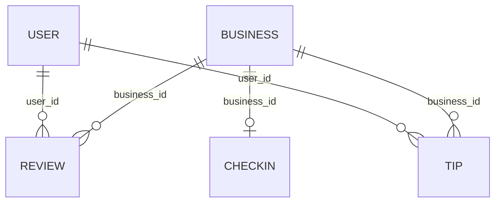

<h1 align="center">CoffeeKing: Nashville Coffee Market Analysis</h1>

<p align="center">
  <b>Where should a new coffee startup open its first shop?</b><br>
  An end to end SQL capstone built on 919,271 Yelp reviews and 394 Nashville coffee businesses.
</p>

<p align="center">
  
  
  
  
  
</p>

<p align="center">
  <a href="reports/CoffeeKing_Full_Project_Report.pdf">Full report</a> |
  <a href="notebooks/Coffee_King%20EDA%202026-05-20%2019_35_51.ipynb">SQL notebook</a> |
  <a href="https://saviowork.netlify.app">Portfolio</a>
</p>

---

## Table of Contents

1. [Project Overview](#project-overview)
2. [Headline Results](#headline-results)
3. [Dataset](#dataset)
4. [Approach](#approach)
5. [Findings in Detail](#findings-in-detail)
6. [Original Metrics](#original-metrics)
7. [Recommendations](#recommendations)
8. [SQL Techniques Used](#sql-techniques-used)
9. [Repository Structure](#repository-structure)
10. [How to Reproduce](#how-to-reproduce)
11. [Limitations and Next Steps](#limitations-and-next-steps)
12. [Licence](#licence)
13. [About the Author](#about-the-author)

---

## Project Overview

CoffeeKing is a fictitious startup coffee company planning its first physical location in Nashville, Tennessee. Before committing to a site, management wants evidence on three questions:

1. **Location:** Which zip codes have the best ratings, and how do competition and closure rates vary?
2. **Reviews:** Do shops with more reviews tend to score higher, or do they drift toward the middle?
3. **Schedule:** Do shops that open seven days a week earn better ratings than shops with a focused schedule?

This project answers those questions using SQL only, run in a Databricks notebook against the Yelp Academic Dataset filtered for Nashville. It was completed as the capstone for the **SQL for Data Science** course by the University of California, Davis on Coursera, and followed four milestones: proposal, descriptive statistics, deeper analysis with new metrics, and a storytelling presentation to management.

| Item | Detail |
|---|---|
| Client | CoffeeKing (fictitious Nashville coffee startup) |
| Data | Yelp Academic Dataset, filtered for Nashville, TN |
| Tool | Databricks Free Edition, SQL notebook (18 SQL cells) |
| Scope | 394 coffee and cafe businesses, 919,271 reviews |
| Course | SQL for Data Science Capstone, UC Davis via Coursera |
| Completed | June 3, 2026 |

## Headline Results

| # | Finding | Evidence |
|---|---|---|
| 1 | **Open in zip 37216 (East Nashville)** | 4.19 average stars, only 13 competitors, 69.2% survival rate, second highest Market Opportunity Index |
| 2 | **Operate Monday to Saturday** | Mon to Sat shops average 4.26 stars against 3.57 for 7 day shops, a gap of 0.69 |
| 3 | **Avoid downtown zip 37203** | 78 competing shops, the most in Nashville, but only a 3.65 star average |
| 4 | **Popular shops are not average shops** | Shops with 500 plus reviews score highest at 4.12 stars |
| 5 | **Benchmark against Crema Coffee Roasters** | Highest Quality Score in the dataset at 13.50 |

Of the three starting hypotheses, one was supported and two were disproved. The disproved ones changed the recommendation, which is why they were the most useful part of the project.

## Dataset

The Yelp Academic Dataset was loaded into Databricks as five Delta tables arranged in a star schema centred on `business`.



| Table | Rows | Key columns |
|---|---:|---|
| `business` | 6,971 | name, stars, review_count, categories, hours, postal_code, is_open, attributes |
| `review` | 919,271 | review_id, business_id, user_id, stars, text, date |
| `tip` | 54,115 | business_id, user_id, text, date, compliment_count |
| `checkin` | 6,178 | business_id, date (comma separated multi value list) |
| `user` | 180,431 | user_id, average_stars, review_count, fans, yelping_since, elite |

The coffee subset used throughout the analysis contains **394 businesses** with an average rating of 3.7 stars. Of these, 266 are open and 128 have permanently closed, a closure rate of 33%.

> The dataset is not redistributed in this repository. It can be obtained from Yelp under their dataset terms.

## Approach

### 1. Data cleaning and quality checks

Seven documented steps were run before any analysis:

1. Row count profiling across all five tables with `UNION ALL`
2. Column and type inspection with `DESCRIBE TABLE`
3. NULL assessment using `COUNT()` on every key column
4. Star rating validation, confirming only the nine valid Yelp values (1.0 to 5.0)
5. Coffee category filter using `LOWER(categories) LIKE` to isolate 394 businesses
6. Coffee subset summary statistics
7. Data type correction, casting `postal_code` from bigint to string to preserve formatting

Quality issues found and handled:

- `postal_code` was inferred as an integer, so `CAST(postal_code AS STRING)` is used in every location query
- `hours` and `attributes` are JSON strings, so `LIKE` pattern matching was used instead of full JSON parsing
- 285 business records (4.1%) had no address and were excluded from address based queries only
- A few chain businesses (for example Starbucks) appear in the coffee filter and were flagged during the JOIN analysis

### 2. Milestones

| Milestone | Focus | Key outputs | Report |
|---|---|---|---|
| 1. Proposal | Business questions and hypotheses | Zip code ranking, review volume buckets, schedule comparison | [Milestone 1](reports/CoffeeKing_Milestone1.pdf) |
| 2. Descriptive statistics | Distributions and spread | Five number summary, star tier analysis, survival rates by zip | [Milestone 2](reports/CoffeeKing_Milestone2.pdf) |
| 3. Beyond descriptive stats | Correlation and new metrics | Pearson correlations, Quality Score, Market Opportunity Index, JOIN analysis | [Milestone 3](reports/CoffeeKing_Milestone3.pdf) |
| 4. Storytelling | Present to management | 16 slide deck with charts, tables and recommendations | Covered in the [full report](reports/CoffeeKing_Full_Project_Report.pdf) |

## Findings in Detail

### Location (Q1)

| Zip code | Shops | Avg stars | Total reviews | Open | Closed |
|---|---:|---:|---:|---:|---:|
| 37220 | 3 | 4.67 | 93 | 2 | 1 |
| 37206 | 31 | 4.24 | 4,125 | 19 | 12 |
| **37216** | **13** | **4.19** | **626** | **9** | **4** |
| 37208 | 19 | 4.16 | 3,102 | 10 | 9 |
| 37203 | 78 | 3.65 | 7,034 | 56 | 22 |

**Hypothesis 1 supported.** Downtown 37203 has the most shops and one of the lowest ratings. High competition and tourist volume create a race to the bottom on quality perception.

### Review volume (Q2)

| Review bucket | Shops | Avg stars | Median reviews |
|---|---:|---:|---:|
| Under 50 | 231 | 3.53 | 23 |
| 50 to 199 | 116 | 3.89 | 98 |
| 200 to 499 | 34 | 4.04 | 299 |
| 500 plus | 13 | 4.12 | 859 |

**Hypothesis 2 disproved.** Instead of regressing toward the mean, quality and popularity rise together.

### Operating schedule (Q3)

| Schedule | Shops | Avg stars | Currently open |
|---|---:|---:|---:|
| Mon to Sat (6 days) | 37 | 4.26 | 21 |
| Weekdays only | 22 | 4.05 | 10 |
| Other or irregular | 56 | 3.84 | 24 |
| 7 days a week | 279 | 3.57 | 211 |

**Hypothesis 3 disproved.** Focused independent cafes outperform high volume seven day operations by 0.69 stars.

### Descriptive statistics

| Statistic | Star ratings | Review counts per shop |
|---|---:|---:|
| Mean | 3.702 | 96.1 |
| Standard deviation | 0.923 | 174.4 |
| Median | 4.0 | 39 |
| Minimum | 1.0 | 5 |
| Maximum | 5.0 | 1,725 |

The review count mean is more than 2.5 times the median, which signals strong right skew. For that reason, review based analysis in this project uses the **median** as the main measure of central tendency.

### Correlations

| Variable pair | Pearson r | Reading |
|---|---:|---|
| stars and review_count | +0.1587 | Weak positive |
| stars and is_open | -0.1186 | Weak negative |
| review_count and is_open | +0.1435 | Weak positive |

All three are weak, so no single variable explains success. That justified building a composite metric.

## Original Metrics

### Quality Score

Rewards both rating and engagement. A 5.0 star shop with 2 reviews is not proven, while a 4.5 star shop with 1,000 reviews is. The logarithm stops review giants from dominating.

```sql
ROUND(stars * LOG10(review_count + 1), 3) AS quality_score
```

| Rank | Business | Stars | Reviews | Zip | Quality Score |
|---:|---|---:|---:|---|---:|
| 1 | Crema Coffee Roasters | 4.5 | 998 | 37210 | 13.498 |
| 2 | Milk and Honey Nashville | 4.0 | 1,725 | 37203 | 12.948 |
| 3 | The Garden Brunch Cafe | 4.5 | 712 | 37208 | 12.839 |
| 4 | Fido | 4.0 | 1,260 | 37212 | 12.403 |
| 5 | Sunflower Cafe | 4.5 | 561 | 37204 | 12.374 |

### Market Opportunity Index

A composite score per zip code: quality of the existing market (50%), room to enter given competition (30%), and market stability (20%).

```sql
ROUND(
  (AVG(stars) / 5.0) * 0.5 +
  (1.0 - COUNT(*) / 100.0) * 0.3 +
  (SUM(CASE WHEN is_open = 1 THEN 1.0 ELSE 0 END) / COUNT(*)) * 0.2
, 4) AS opportunity_index
```

| Rank | Zip | Avg stars | Shops | Survival | Index |
|---:|---|---:|---:|---:|---:|
| 1 | 37220 | 4.67 | 3 | 66.7% | 0.8910 |
| 2 | **37216** | 4.19 | 13 | 69.2% | **0.8187** |
| 3 | 37210 | 3.68 | 11 | 72.7% | 0.7806 |
| 4 | 37215 | 3.63 | 15 | 80.0% | 0.7783 |
| 9 | 37206 | 4.24 | 31 | 61.3% | 0.7538 |
| 10 | 37203 | 3.65 | 78 | 71.8% | 0.7510 |

Zip 37220 ranks first but has only 3 shops, which is too small a sample to trust. Zip 37216 is the strongest result with meaningful competition behind it.

## Recommendations

1. **Open in zip 37216 (East Nashville).** Supported by four independent analysis methods.
2. **Operate Monday to Saturday.** Use Sunday for staff training, quality review and supplier relationships.
3. **Target 4.0 stars or higher from opening day.** The market median is 4.0, and 53.3% of shops already reach it.
4. **Avoid downtown zip 37203.** Most competitive, lowest quality perception.
5. **Benchmark against Crema Coffee Roasters.** Aim for a Quality Score of 12.0 or above within 18 months, roughly 4.3 stars with 300 or more reviews.

## SQL Techniques Used

| Category | Techniques |
|---|---|
| Querying | `SELECT`, `WHERE`, `GROUP BY`, `HAVING`, `ORDER BY`, `LIMIT` |
| Aggregation | `COUNT`, `AVG`, `SUM`, `MIN`, `MAX`, `STDDEV`, `PERCENTILE` |
| Conditional logic | `CASE WHEN ... THEN ... ELSE ... END` |
| Text and type handling | `LOWER()`, `LIKE`, `CAST(... AS STRING)` |
| Set operations | `UNION ALL` |
| Window functions | `SUM() OVER()` |
| Statistics and math | `CORR()`, `LOG10()`, `ROUND()`, `ABS()` |
| Joins | `INNER JOIN` between `business` and `review` |
| Profiling | `DESCRIBE TABLE` |

The JOIN analysis compared Yelp's published business rating with the mean of individual review ratings. The largest gap found was only 0.29 stars, which supports using the business level rating throughout.

## Repository Structure

```
CoffeeKing-Nashville-sql/
├── notebooks/
│   └── Coffee_King EDA 2026-05-20 19_35_51.ipynb
├── reports/
│   ├── CoffeeKing_Full_Project_Report.pdf
│   ├── CoffeeKing_Milestone1.pdf
│   ├── CoffeeKing_Milestone2.pdf
│   └── CoffeeKing_Milestone3.pdf
├── LICENSE
└── README.md
```

| File | Description |
|---|---|
| [`notebooks/Coffee_King EDA 2026-05-20 19_35_51.ipynb`](notebooks/Coffee_King%20EDA%202026-05-20%2019_35_51.ipynb) | Notebook with the 18 SQL cells: data cleaning, descriptive statistics, correlations, the two original metrics and the JOIN analysis |
| [`reports/CoffeeKing_Full_Project_Report.pdf`](reports/CoffeeKing_Full_Project_Report.pdf) | Complete written report covering all four milestones, results and recommendations |
| [`reports/CoffeeKing_Milestone1.pdf`](reports/CoffeeKing_Milestone1.pdf) | Milestone 1: project proposal, research questions and hypotheses |
| [`reports/CoffeeKing_Milestone2.pdf`](reports/CoffeeKing_Milestone2.pdf) | Milestone 2: descriptive statistics and understanding the data |
| [`reports/CoffeeKing_Milestone3.pdf`](reports/CoffeeKing_Milestone3.pdf) | Milestone 3: correlations, new metrics and cross table analysis |
| [`LICENSE`](LICENSE) | MIT licence covering the code and analysis only |

## How to Reproduce

1. Obtain the Yelp Academic Dataset and filter it for Nashville, TN (five CSV files: business, review, tip, checkin, user).
2. Create a free Databricks Free Edition workspace.
3. Upload the five CSV files and create Delta tables named `business`, `review`, `tip`, `checkin` and `user`.
4. Import the notebook from the `notebooks/` folder into your workspace. Databricks can import `.ipynb` files directly.
5. Run the SQL cells in order. Each cell keeps its query and its result together.

## Limitations and Next Steps

- **Single data source.** Yelp ratings reflect reviewers, not all customers, and the analysis does not include foot traffic, rent or demographics.
- **Chain contamination.** A few chain businesses appear in the coffee filter and should be excluded in a refined version.
- **JSON columns.** `hours` and `attributes` were queried with pattern matching rather than fully parsed, which limits schedule detail.
- **Small samples.** Some zip codes (for example 37220 with 3 shops) have too few businesses for firm conclusions.
- **Next steps:** exclude chains, parse the JSON columns for exact opening hours, add sentiment analysis of review text, and track rating trends over time using review dates.

## Licence

The code and analysis in this repository are released under the [MIT Licence](LICENSE). The Yelp Academic Dataset is not covered by this licence and remains subject to Yelp's own terms. This project is for educational and portfolio purposes.

## About the Author

**Savio Kenneth Myers**, Data Analyst

- Portfolio: [saviowork.netlify.app](https://saviowork.netlify.app)
- GitHub: [savio-kenneth-myers](https://github.com/savio-kenneth-myers)
- Certificate: SQL for Data Science Capstone, UC Davis via Coursera ([verify](https://coursera.org/verify/9G82IHYVPIL8))

<p align="center"><i>CoffeeKing is a fictitious company. This project was completed for educational purposes. The dataset belongs to Yelp and is subject to its terms.</i></p>
